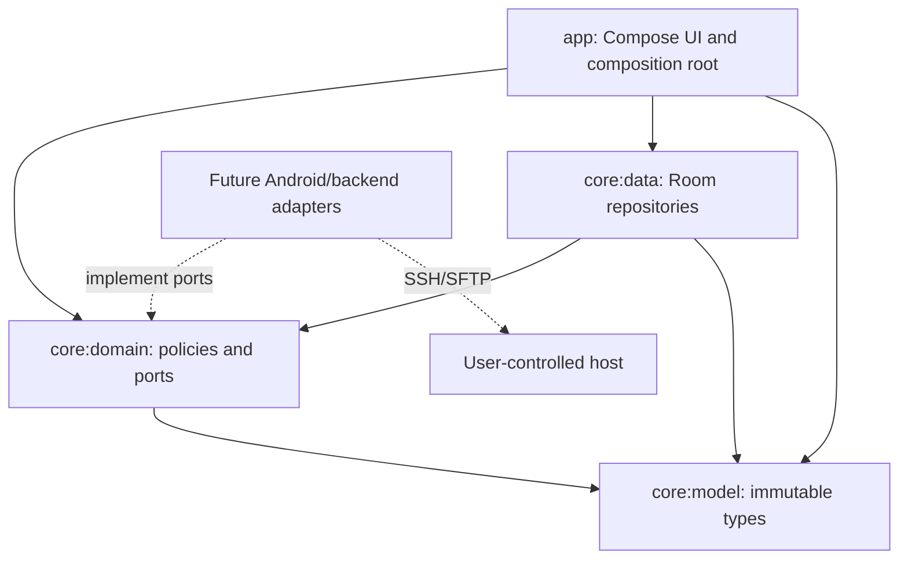

# System design

Working name: **Terminal Workspace** (`dev.terminalworkspace`). Research reviewed 25 November 2026. This document defines the target design; the initial repository implements only a workspace/journal foundation. SSH, SFTP, a terminal emulator, credentials, SAF synchronization, background sessions, and a local Linux runtime are later stages unless explicitly identified in the source code.

## Implemented foundation versus target design

The current source models workspace IDs/names/backend kind, task status and exit evidence, and digest-based synchronization decisions. Room stores workspace metadata and current task rows; repositories expose observation, draft insertion, transactional status changes and interrupted-task recovery. The Compose screen can create/list workspace metadata and display existing journal rows. It does not yet create a project directory, select/open a workspace, edit/save files, submit task drafts from the UI, or record an immutable event history/output transcript. Command drafts in the repository are distinct from future editor file drafts. Build and device-test results are reported in the [README](../../README.md); a source review is not a passing device test.

The remainder specifies the intended system. The module responsibility table includes future location/backend interfaces; they are not claims that those adapters or all listed model types already exist.

## Product boundary

The app owns a project, its drafts and file replicas, and an honest record of what happened. Execution is initially remote. This gives Android users a useful workspace without requiring a second Linux distribution or promising that Android will keep arbitrary children alive. A terminal screen is one view into this workspace, alongside Files, Changes, and Journal.

The opportunity is a shorter, safer edit/run/recover loop. Termius documents a mobile download → external editor → return → upload workflow. Moshi already reconnects to tmux/Herdr and provides agent-oriented files/diffs. Therefore neither SFTP nor reconnect alone is a differentiator. Conflict handling, drafts, and recovery must be measured against those products, not described as universally absent. See [Termius mobile file editing](https://docs.termius.com/organize-and-connect-to-hosts/managing-files-with-sftp) and [Moshi session restoration](https://getmoshi.app/docs/terminal-sessions).

## Module and ownership map

| Module | Responsibility | Excluded responsibility |
| --- | --- | --- |
| `core:model` | Stable identifiers, workspace locations, task/event state and immutable values | Android `Context`, database annotations, credentials |
| `core:domain` | Repository/backend ports and deterministic policies such as save preconditions and recovery classification | Sockets, shell invocation, UI and Room |
| `core:data` | Android persistence, entity mapping and repository implementations | Owning UI state or inventing successful execution |
| `app` | Dependency composition, screens, lifecycle-aware state collection and user actions | Direct SQL or protocol code |

These are logical dependency directions; adapters are introduced only with a working vertical slice. Do not pre-create many empty feature modules. Prefer one application-scoped repository/database instance and constructor injection until a dependency framework solves an actual composition problem. Android recommends repositories, unidirectional state flow, coroutines and Compose; the small JVM domain boundary is our choice to test reliability rules without an emulator. [Android architecture guidance](https://developer.android.com/topic/architecture/recommendations).

## Workspace identity and locations

A workspace has an opaque ID, a human name, a local private root and optional external/remote bindings. A file is identified by workspace-relative segments and binding identity, never by a display label. Keep these location types separate:

| Location | Meaning | Access |
| --- | --- | --- |
| Private workspace | Canonical local working copy and drafts | Ordinary app-private file APIs |
| SAF document/tree | User-selected import/export endpoint | `ContentResolver` and persisted URI grant |
| Remote location | Host identity plus remote path | Authenticated SFTP adapter |

A `content://` URI is not a POSIX path and must not be passed to a shell as one. Remote `/home/user/project` and private Android files likewise are different copies, even when their names match. The UI shows the execution target and save destination. A later local backend receives only a verified private working directory.

SAF permissions can disappear; providers can be offline, remote, read-only or lack rename. Provider flags and actual operation results determine available actions. Persist grants where offered, but handle revoked grants with a reselect action. Keep work in private persistent files, not a cache directory; provide explicit export because uninstall removes private data. [SAF contracts](https://developer.android.com/training/data-storage/shared/documents-files), [private-storage lifecycle](https://developer.android.com/training/data-storage/app-specific).

Reject traversal outside an assigned root. Remote paths are protocol strings, not shell source. Before directory transfer define symlink behavior explicitly; default to not following links outside the selected root. Do not recursively copy arbitrary trees before bounding file count, size and available local space.

## Drafts and file revisions

The editor first commits a draft/local revision. Remote synchronization is a separate operation and state; loss of connectivity must not lose the draft. Each binding tracks the base bytes or content hash, local revision, last observed destination revision, and pending operation ID. Size/mtime alone are a quick change hint, not strong identity. Preserve encoding and line endings for round trips; use a binary/download path for unsupported encodings and files above editor limits.

The proposed remote save protocol is:

1. Save locally and persist an operation record before transfer.
2. Re-read the destination and compare it with the base revision. On mismatch retain base/local/remote versions and offer a three-way merge, save-copy, or explicit overwrite.
3. Upload to a uniquely named sibling temporary file using exclusive creation when supported. Complete and close the upload; use supported flush/fsync capabilities where applicable.
4. Recheck the destination immediately before replacement. If changed, keep the draft and stop with a conflict.
5. Prefer a negotiated POSIX-style atomic rename on the same filesystem. Never implement replacement by deleting the original first.
6. Verify the result when practical and record the resulting revision; clean up only temporary files demonstrably owned by this operation.

This reduces lost updates but **does not provide universal compare-and-swap**: another writer may change the target between the final check and rename. Atomic replacement prevents readers from seeing a partial upload; it does not prevent overwriting a concurrently modified file. A stronger contract requires a cooperating server that atomically checks a revision and commits, or an exclusive workflow whose writers honor a lock. Report weaker server capability plainly. Do not label an SFTP-only save “conflict-proof.” OpenSSH defines negotiated `posix-rename` and `fsync` extensions, not a universal revision precondition. [OpenSSH protocol extensions](https://github.com/openssh/openssh-portable/blob/master/PROTOCOL).

On a timeout after rename, classify the outcome as unknown and inspect the target/temp state before retrying. A replacement can change inode identity, link relationships, ownership, permissions or extended attributes; declare the supported metadata contract and reject unsupported/symlink cases rather than claiming desktop filesystem fidelity. SAF exports use the provider's capability contract and may require save-copy instead of atomic replacement. See [ADR 0002](decisions/0002-storage-and-conflict-safe-save.md).

## Session, task and connection are different lifetimes

An interactive PTY carries terminal bytes and screen-size changes. It does not reliably expose the start, current working directory or exit status of each command inside an arbitrary shell. A separate exec channel can produce an exit status for its own command, but that status might never reach the phone. Shell integration is optional, explicitly installed/enabled, and treated as untrusted metadata. Do not parse a prompt and announce task success. The SSH connection protocol defines PTY, shell, exec and exit-status mechanisms separately. [RFC 4254](https://www.rfc-editor.org/rfc/rfc4254).

The target design separates:

- **Connection:** disconnected, connecting, authenticating, connected, failed; holds short-lived protocol resources.
- **Session:** a terminal route with optional remote multiplexer identity; a route can be reattached with a new connection.
- **Task:** a user-labelled execution intent plus evidence about dispatch and outcome; terminal input does not automatically become a structured task.
- **Journal:** durable observations available offline; its survival says nothing about remote process survival.

For tracked execution, persist intent before dispatch. A transport write returning means bytes were handed to a channel, not that the server executed them. If the connection is lost before a trustworthy completion event, use `UNKNOWN`/“outcome unknown”; do not turn disconnection into success, failure or safe-to-retry. Never automatically replay arbitrary commands. A future cooperating runner can support request IDs and queryable task state, with explicit retention and deduplication contracts.

An optional, user-selected tmux route can preserve a remote shell. Probe only after an explicit connect/setup action, show the command that will run, and attach only the chosen session. Do not silently alter shell startup files, install host software or run bootstrap scripts. Mosh may improve roaming later; its server and UDP requirements remain, and it does not replace SFTP or tunnels. [ConnectBot's Mosh contract](https://connectbot.org/guides/mosh/).

## Journal durability and output

Persist durable metadata/events with Room transactions and expose repository flows. The current task journal stores the latest structured task state; an append-only observation history is a later extension, and a lossless terminal recorder is a separate capability. A later recorder uses bounded byte chunks with monotonically increasing sequence numbers, stream identity, capture time, encoding policy, hash and gap markers. Keep decoder state across chunk boundaries; a UTF-8 character or escape sequence can span reads. Store rendered searchable text separately from raw terminal bytes.

Proposed starting limits for a recording spike are 64 KiB chunks, a 100 ms batching interval, a bounded 4 MiB ingest queue, and a visible per-workspace quota; these are **unbenchmarked settings**, not shipping guarantees. On storage pressure stop recording or mark a deliberate gap; do not silently discard and label output complete. Transport flow control and render throttling must remain independent of the UI refresh rate. Benchmark before selecting limits.

Acknowledging a saved journal entry follows the database transaction result. For a file-backed chunk store, write/flush/rename the chunk before committing its index; reconcile orphaned chunks or missing files on startup. Database and separate-file commits are not one atomic transaction. Define whether “saved” protects against ordinary process death or also a sudden power failure, then test the selected SQLite/filesystem synchronization settings. Room supplies SQLite access and migrations; it does not imply infinite durability or transport recovery. [Room](https://developer.android.com/training/data-storage/room), [SQLite commit assumptions](https://www.sqlite.org/atomiccommit.html).

Persist a reconnect boundary and display that remote output may have been missed. A phone cannot reconstruct bytes emitted while it was disconnected. Durable remote logs/runner capture are a separate opt-in capability. Mosh itself transmits screen state rather than full scrollback. [Moshi's documented history limits](https://getmoshi.app/docs/scrolling). See [ADR 0003](decisions/0003-journal-and-session-lifetime.md).

## Android lifecycle

### Local-network access on the selected target SDK

This scaffold targets API 37. Before implementing LAN SSH/SFTP/Mosh, account for Android 17's enforced local-network protection: apps targeting API 37+ need the appropriate `ACCESS_LOCAL_NETWORK` runtime grant for ordinary direct LAN sockets, or a supported system-mediated picker route. Check permission after the user chooses a local host; handle denial/revocation distinctly from authentication and server reachability. Public-internet connectivity is a separate case. The starter requests neither networking permission because it has no transport. Test IPv4/IPv6, hostname resolution and VPN routes against the final platform contract. [Android local-network enforcement](https://developer.android.com/privacy-and-security/local-network-permission).

UI recreation restores workspace selection and drafts from persistence. It never owns the only reference to a live session. A later user-visible session service may own socket/backend jobs under a structured scope, with clear disconnect/stop actions and notification controls. Implement the service only after identifying the correct service type and permissions for the target Android release; never borrow a media/location type to keep a shell alive.

WorkManager is for retryable reconciliation/cleanup with explicit operation identity, not a continuous interactive terminal or replaying unknown commands. A foreground service is a user-visible execution mechanism with restrictions; it is not immunity from low-memory kills, force-stop, network loss or OEM policy. On startup classify previously active connections/tasks as requiring reconciliation. [Android foreground-service rules](https://developer.android.com/develop/background-work/services/fgs), [offline queue guidance](https://developer.android.com/topic/architecture/data-layer/offline-first).

## Security boundaries

The starter has no SSH credential store. Before adding transport, require host-key verification before authentication; explicit trust-on-first-use with fingerprints; a blocking changed-key flow; bounded keyboard-interactive prompts; and no trust-all verifier. Authentication must support cancellation without stale channels. Secrets must not appear in journal titles, diagnostics or analytics. Remote names, paths, output and control sequences are untrusted input.

Store future key references separately from workspace metadata. Prefer Android Keystore-backed signing where the chosen algorithm and device support it. Imported SSH private keys generally need encrypted storage and in-memory decoding; do not call an exportable imported key “non-exportable hardware backed.” A Keystore wrapping key protects an encrypted blob but does not transform that SSH key into a hardware-held signing key. [Android Keystore guarantees](https://developer.android.com/privacy-and-security/keystore).

Require explicit clipboard actions; gate OSC 52 clipboard writes per host/session, bound payloads, and disable remote clipboard reads by default. Treat log retention as sensitive: never record hidden password input, offer recording off, deletion and export controls, and acknowledge that echoed output can still contain secrets. App-private storage is not application-level encrypted storage. Future backup rules must exclude credentials and allow user-controlled handling of workspace history.

## Deferred local backend and environment repair

No bundled distro, PRoot download, terminal fork or package installer is necessary for the first product slice. Revisit local execution only after a prototype passes modern target-SDK execution rules, Play/distribution policy review, PTY/process-tree behavior, ABI/page-size support, license review, resource budgets and recovery tests. Android restricts `execve` of writable app-home files for modern targets; lowering the target SDK is not a durable strategy. [Android execution restrictions](https://developer.android.com/about/versions/10/behavior-changes-10#execute-permission).

A later environment manager owns only environments it created. Separate download, signature/checksum verification, staging, activation, validation and rollback. Use versioned environment manifests and immutable verified artifacts, preserve project data, show exact repair actions, and retain the previous generation until validation succeeds. Never “repair” external Termux/UserLAnd trees, erase an arbitrary selected folder, or issue package-manager commands on a remote host automatically.

## Delivery gates

1. **Foundation:** workspace metadata, persistent drafts/journal, deterministic policy tests, honest disabled execution controls.
2. **Storage slice:** SAF import/export and private workspace; revocation, failure and uninstall/export UX proven.
3. **Remote slice:** one verified SSH adapter, one terminal adapter and SFTP round trip, host keys and process-death behavior tested.
4. **Reliability slice:** persistent save queue, conflicts, unknown outcomes, bounded recording and explicit resume routes.
5. **Optional runtime:** only after the independent execution/distribution gate passes.

Implementation work should track [product requirements](../product/product-requirements.md), [roadmap](../product/roadmap.md) and [validation plan](../quality/validation-plan.md). Technology choices and unresolved spikes are recorded in [technology evaluation](technology-evaluation.md) and [ADR 0004](decisions/0004-engine-selection-gates.md).
