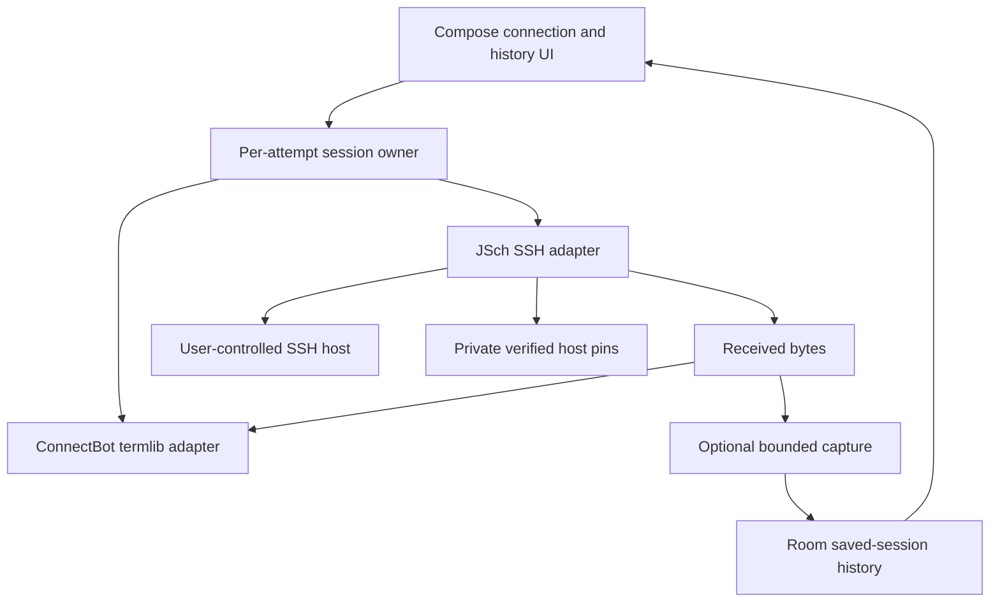

# System design

Working name: **Terminal Workspace** (`dev.terminalworkspace`). Revised **26 November 2026** for the user's preferred fast v1: reuse existing terminal/SSH libraries and deliver a small remote terminal with optional saved received-output history. Advanced project editing, SAF, sync and managed local Linux are later gates. This design does not imply a passing device route; see [implementation status](../implementation-status.md).

## V1 boundary and adopted components

The app owns host/context metadata and optional received-output history. The shell and tools run on the user's remote host. It does not implement a terminal parser, SSH protocol, package manager or Linux distribution. ConnectBot **termlib 0.3.15** provides terminal emulation/rendering/input; **mwiede JSch 2.28.8** provides SSH. These are selected integrations, replacing the earlier unadopted engine shortlist. Exact fixes, provenance, licenses and remaining checks are in the [dependency review](../security/dependency-review.md).

| Layer | Responsibility | Boundary |
| --- | --- | --- |
| `app` | Compose connection/history UI, user trust decisions, paste review and retained terminal/session owner | No SQL or custom terminal parser; UI recreation must not replay input |
| `core:model` | Immutable session/task/workspace values | No credentials or Android resources |
| `core:domain` | Repository contracts, bounded received-output buffer and deterministic policies | No sockets or platform persistence |
| `core:data` | Room repositories and JSch connection/private host-pin adapter | No inferred shell command success; no silent host setup |
| Upstream terminal | ANSI/UTF-8 screen state, keyboard/IME, selection, resizing and native parser | App still controls clipboard/URLs/images, lifecycle, resource budgets and trust |

The earlier workspace/task foundation remains useful source, but its existence is not an editor, executable project directory or sync product. Native Kotlin/Compose and repository boundaries remain accepted. Dependency injection stays simple constructor composition until a framework solves an actual problem. [Android architecture guidance](https://developer.android.com/topic/architecture/recommendations).

## Connection and credential lifetime

Each attempt has a new one-shot `SshClient` and immutable session/history identity. A retained owner starts one output collector before connecting, fans received bytes to the terminal and optional capture, and serializes snapshot persistence. Finish/cancel the old collector before reusing a UI terminal. Old bytes must never be relabeled as a new session's output.

The client supports a password-only PTY route initially. Password bytes are consumed/cleared by the adapter and are not persisted; the UI must clear transient password state and never use saved-instance-state storage for credentials. Managed runtime/library copies prevent a perfect memory-erasure guarantee. Key authentication, imported keys, keyboard-interactive MFA, certificate/CA management, forwarding and Mosh are not initial capabilities.

`send` and resize hand data to the library through bounded operations. A successful socket write is not evidence that a remote command ran or finished. Connection states describe connecting/connected/disconnected/failure; they do not manufacture per-command results. An interactive PTY does not give reliable command boundaries, cwd or individual exit status. [SSH channel semantics](https://www.rfc-editor.org/rfc/rfc4254).

Disconnect/cancel closes the actual socket before library/channel cleanup. One-shot attempt identity and bounded background workers prevent a growing queue of stale sessions. Platform DNS can ignore interruption; bounding such workers is a resource control, not a promise the resolver immediately stops. No automatic reconnect or command replay occurs. Remote work may continue or die according to the host/session; the app makes no stronger claim.

## Host identity and crypto

Use explicit SHA-256 trust-on-first-use approval for an unknown host/port. Show host, port, key type and fingerprint; a user must compare the fingerprint through a trusted path when assurance is needed. Approved pins are staged, verified and atomically stored in app-private `ssh/known_hosts` before authentication. Recheck after approval to catch another concurrent pin change. Changed key bytes or an unexpected key type fail closed without an automatic replacement prompt. A malformed private store is an error, not a reason to forget trust and accept a new key.

Strict host checking stays enabled. V1 configures the supported RSA-SHA2/ECDSA host-key route, modern cipher/MAC choices and required strict key exchange; host-certificate algorithms and certificate-to-key fallback are disabled. No extra Bouncy Castle provider, trust-all verifier or legacy algorithm fallback is added to make a server connect. Unsupported combinations fail clearly and constrain the initial server support statement. Host key **format** `ssh-rsa` in a pin is distinct from enabling an RSA/SHA-1 signature.

Review real handshake tests for unknown rejection before password authentication, accepted pin persistence before authentication, known-key reconnection, changed-key/port scope, pin write failure, damaged-store failure and cancellation. Source configuration and an advisory scan alone cannot prove those behaviors. [Dependency review](../security/dependency-review.md).

## Terminal integration and untrusted output

The owner retains the termlib emulator across configuration changes and closes its native handle when the attempt/view is permanently disposed. Feed transport bytes in order and preserve arbitrary UTF-8/escape read boundaries; the upstream engine owns parsing. Keep callbacks asynchronous with respect to feeding the emulator to avoid native callback reentry/deadlock. Serialize input/send and resize operations where ordering matters.

Remote output is untrusted. The adapter disables OSC 52 clipboard copy and inline image decoding, disables automatic URL detection and provides no automatic external hyperlink intent. The app's Paste… action requests clipboard text explicitly and previews it before sending. An IME may commit clipboard text as ordinary input without that preview; this is a separate input path to test. Password entry is separate from the terminal input/recording path. These choices reduce attack surface but are not a native-parser security guarantee.

The selected termlib source includes known CSI parameter/numeric overflow fixes; three pinned-source host-side sanitizer cases passed. The packaged Android native smoke test also passed on an API 26 x86_64 emulator. Broader malformed sequences, IME/selection/resize, accessibility and physical-device/server behavior still require validation. [Recorded evidence](../security/dependency-review.md).

## Optional received-output history

Capture is **off by default** and chosen per attempt. `ReceivedOutputBuffer` retains a prefix of actual received bytes up to **256 KiB**, with a revision and explicit truncation flag. Room keeps at most **20** session records. This small v1 reuses ordinary structured persistence; it does not implement a custom chunk store, distributed runner or terminal transcript protocol.

Do not record typed input. Remote echo can still contain passwords/tokens, so capture needs visible consent, deletion and a clear privacy description. App-private Room storage is not an application-encrypted vault. Keep history out of implicit backup/transfer as configured, and verify the final manifest/extraction behavior rather than assuming it from source.

Persist snapshots serially and associate them with captured immutable IDs. An older snapshot must not replace newer output/truncation state. Only content committed by the repository can be called saved; bytes between flushes may be lost on abrupt process death. Startup changes previously connecting/connected history records to interrupted. Deletion does not insert data again on a late update.

Raw retained bytes are not full native screen state or a complete remote transcript. Truncation may cut a UTF-8 character/escape sequence at the boundary; history viewing must disclose that limitation and never claim a complete final terminal state. Output emitted while disconnected was not received and cannot be reconstructed by the client. A later remote log/runner contract would be a separate opt-in capability. Mosh likewise is screen transport rather than permanent scrollback. [Moshi's documented history limits](https://getmoshi.app/docs/scrolling).

## Android lifecycle and permissions

### Local-network access on the selected target SDK

The selected target is API 37. Internet access is required for SSH; local hosts also need the appropriate Android local-network runtime permission/system-mediated route. Prompt in response to the user's chosen connection and handle denial/revocation separately from server/auth failures. Test direct sockets, IPv4/IPv6, hostname resolution and VPN routes against the selected SDK contract. The final UI/manifest permission route must be verified on device. [Android local-network permission](https://developer.android.com/privacy-and-security/local-network-permission).

A retained owner survives UI configuration changes; it does not survive process death. V1 restores saved app context/history and reconnects only deliberately. It has no foreground-service immortality guarantee. If a later release adds a user-visible session service, validate its actual service type, permission/start restrictions and stop controls; never borrow media/location behavior to keep SSH alive. [Foreground-service rules](https://developer.android.com/develop/background-work/services/fgs).

WorkManager may later perform retryable reconciliation, never automatic replay of an unknown command. Room provides SQLite persistence and migration mechanisms, not guaranteed remote continuity or immunity to sudden hardware/power failure. [Room](https://developer.android.com/training/data-storage/room), [SQLite commit assumptions](https://www.sqlite.org/atomiccommit.html).

## Later gates rather than v1 dependencies

| Capability | Required design/validation before adoption |
| --- | --- |
| Project editor/SAF | Separate app-private working copy from provider URIs; source-preserving staged import, drafts, safe paths, limits and real-device import/edit/save/reopen tests |
| SFTP/conflict handling | Preserve base/local/remote revisions and explicit merge/save-copy choices. Upload staging/atomic rename is not universal compare-and-swap; a check/rename race needs a cooperating endpoint or an explicitly weaker save contract. |
| Semantic task journal | Optional supported shell/runner integration with evidence-based outcomes, IDs and capture gaps; no prompt parsing presented as reliable command completion |
| Multiplexer/Mosh | Explicit user setup, server/network compatibility and lifecycle contract; no silent bootstrap or claim of complete unseen output |
| Backup/restore | Actual independent exports, coverage/integrity manifest, safe staged restore and fresh-install drills |
| Managed local Linux | Independent modern Android execution/distribution, ABI, resource, license, update and repair feasibility; potentially months of additional scope |

A SAF URI is not a POSIX path. Future sync/repair must not delete user provider sources or modify external Termux/UserLAnd environments. Local execution cannot assume writable app-home binaries run on a modern target SDK. [SAF](https://developer.android.com/training/data-storage/shared/documents-files), [execution restrictions](https://developer.android.com/about/versions/10/behavior-changes-10#execute-permission). Earlier storage/task ADRs retain these constraints for later work; the [roadmap](../product/roadmap.md) governs the revised order.

## Delivery and evidence gates

1. Select and review the reused engines, exact provenance/notices and known fixes.
2. Complete host/port/username entry → verified identity → authenticate → terminal → disconnect → reopen optional history; no profile/command manager is implied.
3. Run loopback/JVM checks, compile/build/lint checks and actual Android permission/input/lifecycle/security route; label unrun work honestly.
4. Harden the narrow product with device/IME/accessibility coverage and field use before expanding scope.
5. Add editor/sync/runtime work only after its own usefulness and feasibility gates pass.

The [delivery estimate](../product/delivery-estimate.md) separates the conditional 3–7 focused-day v1 target from 6–10 week hardening. [Validation](../quality/validation-plan.md), [notices](../security/THIRD_PARTY_NOTICES.md) and [implementation status](../implementation-status.md) carry actual results and remaining limits.
